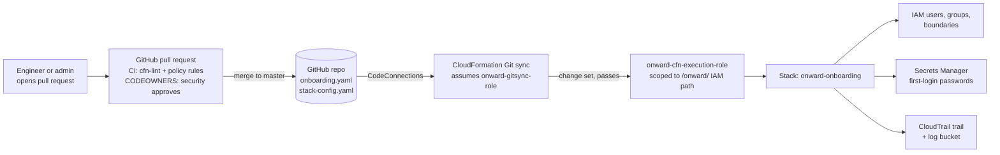
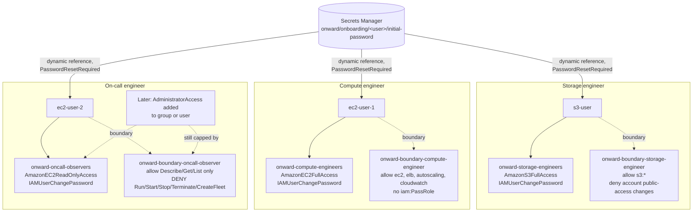

# Architecture

## How a change to access reaches AWS

## How access is controlled

Effective permissions are the **intersection** of what the group grants and
what the boundary allows. An explicit deny anywhere always wins.

